# Docker I - Ejercicios

## Ejercicio 1

- Crea una máquina virtual con Alpine llamada "Alpine base".
- Instala Docker en la máquina virtual.
- Comprueba que todo se ha instalado correctamente.

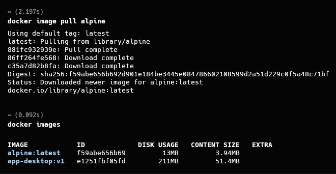

## Ejercicio 2

- Busca por terminal la imagen de Docker **hello-world**.
- ¿Cuál de todas las imágenes es la oficial?

La oficial es `hello-world`, la que no tiene usuario delante y está marcada como OFFICIAL.

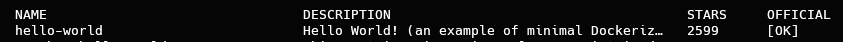

- Haz lo mismo, pero en DockerHub. Marca a la izquierda la casilla **Docker Official Image** y comprueba que coincide con tu elección del punto anterior.

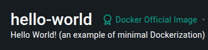

- Descarga y ejecuta la imagen elegida en tu ordenador.
- Haz lo mismo con la imagen **hello-seattle**.
- Muestra las imágenes descargadas en tu ordenador.

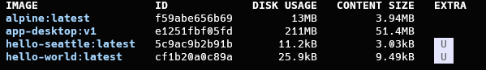

- Intenta borrar la imagen *hello-seattle*. ¿Por qué te está dando error?

Da error porque hay un contenedor creado a partir de esa imagen. Primero hay que borrar el contenedor.

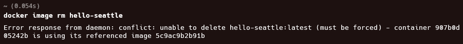

- Lista los contenedores de tu ordenador con la opción **ls** sin parámetros. ¿Ves algún contenedor de la imagen *hello-seattle*?

No aparece, porque `ls` solo muestra los contenedores que están en ejecución.

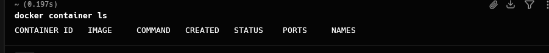

- Vuelve a listar los contenedores con la opción **ls -a**. ¿Por qué ahora sí que se muestra el contenedor de la imagen *hello-seattle*? ¿Para qué sirve la opción *-a*?

La opción `-a` muestra todos los contenedores, también los que están parados.

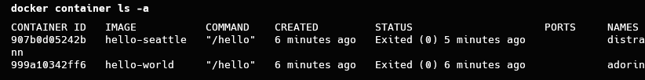

- Elimina el contenedor que usa *hello-seattle* y la imagen.
- Vuelve a listar las imágenes y comprueba que se ha borrado correctamente.

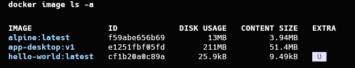

## Ejercicio 3

- Crea una imagen derivada de la imagen *hello-world* descargada en el ejercicio anterior con **docker image tag** llamada **smr/hola-mundo**.
- Borra la imagen original (*hello-world*).

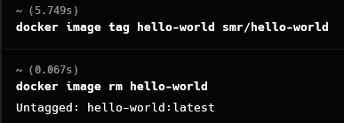

- Guarda la nueva imagen creada en el fichero smr-hola-mundo.tar

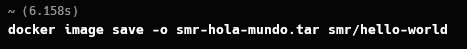

- Borra la imagen docker **smr/hola-mundo** y comprueba que no tienes ninguna imagen.

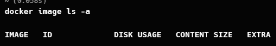

- Añade la imagen **smr/hola-mundo** mediante **docker image load** usando el archivo .tar creado anteriormente.

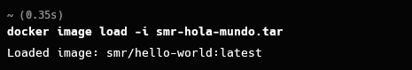

## Ejercicio 4

- Descarga la imagen oficial de mysql.
- Con la imagen que te has descargado, crea un contenedor con nombre **mysql_smr** y **smr** como password del usuario *root*.
- Ejecuta desde la terminal la orden:

```
docker container exec -it mysql_smr mysql -u root -p
```

- Comprueba que puedes conectarte al Mysql del contenedor.

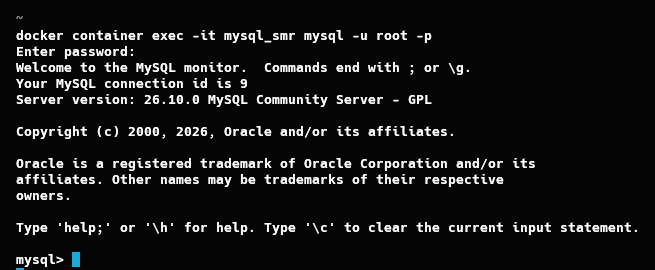

- Ejecuta la siguiente orden dentro de Mysql para crear una nueva base de datos:

```
CREATE DATABASE prueba;
```

- Comprueba que se ha creado la bbdd con la orden:

```
show databases;
```

## Ejercicio 5

- Para el contenedor *mysql_smr* y vuelve a iniciarlo.

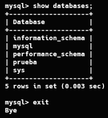

- Conéctate de nuevo a Mysql y comprueba que la bbdd *prueba* sigue estando.

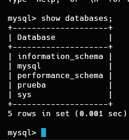

- Elimina el contenedor *mysql_smr*.
- Vuelve a crearlo con los mismos parámetros y comprueba que la bbdd *prueba* no existe.

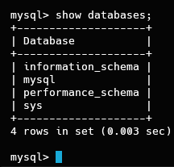

- Sal del contenedor y elimínalo.

## Ejercicio 6

- Crea un directorio llamado **mysql_data**.
- Vuelve a crear el contenedor *mysql* con los mismos parámetros anteriores pero indicando que la carpeta del contenedor */var/lib/mysql* se guardará en el directorio recién creado (*mysql_data*).

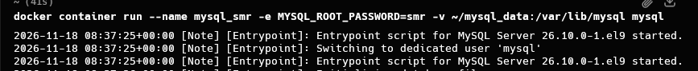

- Crea de nuevo la bbdd *pruebas* dentro del Mysql del contenedor.
- Sal y elimina el contenedor.
- Crea de nuevo el contenedor sin mapear ninguna carpeta (sin utilizar volúmenes) y comprueba que la bbdd *prueba* no existe.

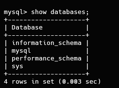

- Vuelve a salir y eliminar el contenedor.
- Crea de nuevo el contenedor pero mapeando la carpeta igual que antes (la carpeta */var/lib/mysql* del contenedor se guardará en *mysql_data*).
- Comprueba que la bbdd sigue estando en Mysql.

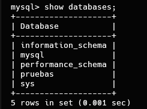

## Ejercicio 7

- Crea un directorio llamado **php_data**.
- Crea un archivo llamado **index.php** en el directorio recién creado con el siguiente contenido:

```php
<?php
phpinfo();
```

- Arranca un contenedor con la imagen php:8.0-apache y nombre **php_smr** indicando que la carpeta del contenedor */var/www/html* se guardará en la carpeta creada en el primer punto. Además, el puerto 80 del contenedor se mapeará al puerto 8085 de la máquina real.
- Abre un navegador, accede a `http://ip_maquina_virtual:8085` y comprueba que se muestra una página similar a ésta:

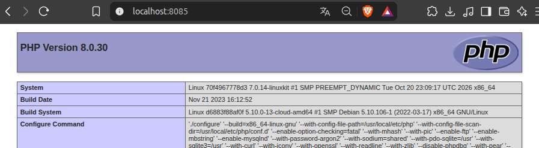

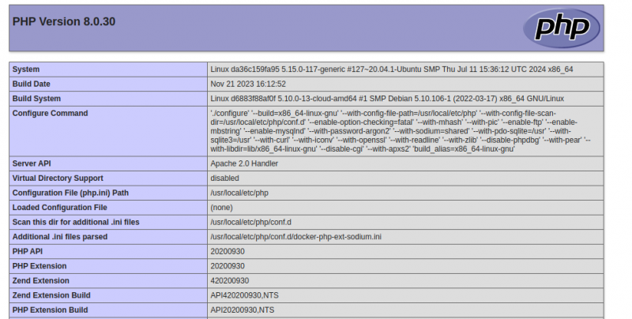

- Reinicia la máquina virtual.
- Comprueba que accediendo a la anterior url se produce un error.

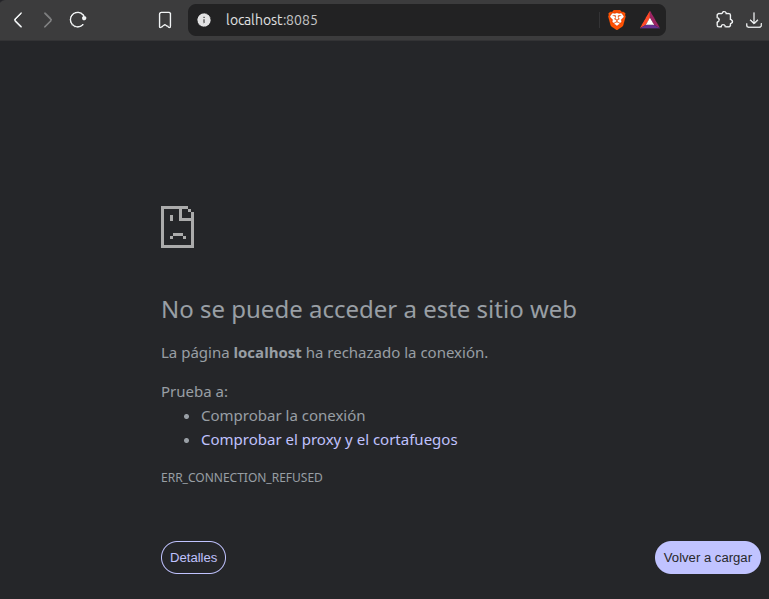

- Borra el contenedor.
- Vuelve a crear el contenedor pero ahora añade que siempre se reinicie.

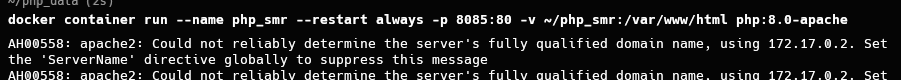

- Reinicia la máquina virtual.
- Comprueba que navegando a la anterior url ahora sí que funciona.

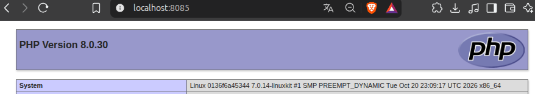
